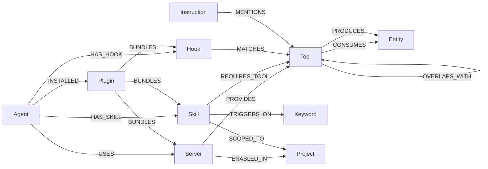

# ToolGraph

**The connected map of your AI agent's own toolbox.** ToolGraph reads your Claude Code setup (MCP servers, their tools, skills, plugins, hooks, CLAUDE.md files, per-project enablement) into one [Relate](https://relatedb.ai) graph. Then it answers the questions only paths can answer: *which tools, in what order?*, *what breaks if I remove this server?*, *which skills point at tools I don't have?*, and *which 8 tools are worth loading for this goal?*

No API keys, no server, no signup. One command gets you a result from fixture data, and the graph is a single 230 KB `.rl` file committed in this repo.

```text
$ toolgraph ask "I want to open a PR on my repo from a Jira ticket"
from jira_issue -> to pull_request   (you have: repository)
  1. jira-flow_atlassian.getAccessibleAtlassianResources produces atlassian_site for jira-flow_atlassian.getJiraIssue
  2. jira-flow_atlassian.getJiraIssue                 turns jira_issue into text
  3. github.create_branch                             produces branch for github.create_pull_request
  4. github.create_pull_request                       turns text into pull_request
```

---

## Use case

Everyone who uses Claude Code, Cursor or Codex now has dozens of MCP servers, hundreds of tools and a pile of skills, plugins and hooks. Nobody can see how they fit together:

- **Tool descriptions bloat context.** Every tool schema is loaded into every session. Claude Code had to add deferred tool search for this reason.
- **Skills silently depend on tools that aren't installed.** A skill says "move the Linear ticket to Done" and you removed Linear months ago.
- **Two skills trigger on the same phrase.** Say "deploy" and three skills compete for it.
- **Nobody knows what removing a server breaks.** A hook, two skills and a CLAUDE.md rule may all depend on it.

The **intended user** is a developer running an agent with many MCP servers and skills. That includes me: I'm a founder who lives in Claude Code. They use ToolGraph from the terminal, or (better) let the agent ask its own toolbox through ToolGraph's MCP server.

## How it uses Relate

| | |
|---|---|
| **Mode** | Embedded, **single file**: `data/toolgraph.rl` via the Python binding (`pip install relate-db`, `import relate`). |
| **Why** | The graph is a build artifact of your config: portable, inspectable, diffable in a repo, and openable by the `relate` CLI or `relate serve --mcp`. No database to run. |
| **Cypher features used** | `UNWIND $batch` + `MERGE` bulk ingest in one transaction; Cypher 25 **quantified path patterns with `SHORTEST 1`** for routing; variable-length and `EXISTS {}` subqueries for blast radius and audit; **full-text indexes + `SEARCH`**; optional **vector index + `SEARCH` + reciprocal-rank fusion** for hybrid retrieval. |
| **Agent access** | `toolgraph serve` is an MCP server (5 tools). The raw graph also works with `relate serve --mcp stdio --database data/toolgraph.rl --read-only`. |

All queries live as plain Cypher in [`src/toolgraph/cypher/`](src/toolgraph/cypher). The routing query is:

```cypher
MATCH p = SHORTEST 1 (a:Entity {name: $from})
      (()<-[:CONSUMES]-(t:Tool WHERE $servers IS NULL OR t.server IN $servers)-[:PRODUCES]->()){1,6}
      (b:Entity {name: $to})
RETURN [x IN t | x.id] AS tools, [n IN nodes(p) | coalesce(n.id, n.name)] AS chain
```

## What the graph models



| Node | From | Key properties |
|---|---|---|
| `Server` | `~/.claude.json`, project `.mcp.json`, plugin manifests | `id` (the `mcp__<id>__` prefix), `scope` user/project/plugin/builtin, `tokens` |
| `Tool` | `tools/list` schemas | `id` e.g. `mcp__github__create_branch`, `description`, `tokens`, `missing` (true for **ghost tools**: referenced but not installed) |
| `Entity` | inferred | `repository`, `branch`, `pull_request`, `jira_issue`, `file_path`, `url`, ... (`generic` for plain text inputs) |
| `Skill` | `SKILL.md` (user, project, plugin) | `name`, `description`, `scope` |
| `Keyword` | quoted trigger phrases in a skill description | `text` |
| `Hook` | `settings.json` / plugin `hooks.json` | `event`, `matcher` (regex over tool ids) |
| `Instruction` | `CLAUDE.md` files | `path` |
| `Plugin`, `Project`, `Agent` | plugin manifests, `~/.claude.json` | |

**Entities are inferred without any model.** A synonym map over JSON-schema property names gives `CONSUMES`: `owner`+`repo` → `repository`, `head`/`base` → `branch`, `issueIdOrKey` → `jira_issue`. Phrase rules over the "Returns ..." clause of a description give `PRODUCES`. `OVERLAPS_WITH` links tools on different servers that share entities and read alike. All of it is in [`entities.py`](src/toolgraph/entities.py), deliberately small so a wrong edge is easy to explain and fix.

## Setup: three commands to a first result

Python 3.11+.

```bash
git clone https://github.com/Praveen23-kk/toolgraph && cd toolgraph
pip install -e ".[dev]"          # relate-db + mcp + pytest
toolgraph demo                   # or: make demo
```

`toolgraph demo` rebuilds `data/toolgraph.rl` from the fixtures and answers all four questions. You can also skip the rebuild and query the committed graph directly: `toolgraph audit`.

## The four questions (real output from the fixture graph)

### 1. Route: which tools, in what order?

`route` finds the shortest `Entity ← CONSUMES – Tool – PRODUCES → Entity` chain. Then, for each tool, it resolves required inputs you don't already have by finding the cheapest producer (fewest unmet inputs, same server preferred, fewest tokens). The result is the Jira example at the top of this page. Another:

```text
$ toolgraph route "take a screenshot of a url"
from url -> to screenshot
  1. playwright.browser_navigate                      turns url into page_element
  2. playwright.browser_take_screenshot               turns page_element into screenshot
```

You can also give entities explicitly (`--from jira_issue --to pull_request --have repository`), limit to one project's enabled servers (`--project ~/work/shop-api`), or get a diagram (`--mermaid`).

### 2. Blast radius: what breaks if I remove a server?

```text
$ toolgraph blast github
remove server 'github' (user): 23 tools, ~2669 tokens of context
  enabled in projects: ~/work/data-graph, ~/work/shop-api
  BROKEN    Hook        user-settings#PreToolUse[1.0]      loses 2/2: github.push_files, github.create_or_update_file
  BROKEN    Skill       pr-from-ticket                     loses 3/4: github.create_branch, github.create_pull_request, github.push_files
  BROKEN    Skill       release-deploy                     loses 1/2: github.merge_pull_request
  BROKEN    Skill       standup-notes                      loses 1/2: github.list_commits
  DEGRADED  Instruction user:CLAUDE.md                     loses 1/4: github.push_files
  DEGRADED  Skill       code-search                        loses 1/4: github.search_code
  DEGRADED  Skill       deploy-preview                     loses 1/3: github.get_pull_request_status
  DEGRADED  Skill       triage-incident                    loses 1/4: github.create_issue
  ORPHANED  entity github_issue         nothing else produces it; stranded: -
  ORPHANED  entity pull_request         nothing else produces it; stranded: -
  ORPHANED  entity repository           nothing else produces it; stranded: -
```

*Broken* means the item loses at least half of the installed tools it uses. *Orphaned* entities are ones no other server can produce, so every route that needs them dies too. Add `--mermaid` for a picture.

### 3. Audit: what's already wrong?

```text
$ toolgraph audit
[dangling] 3 reference(s) to tools that are not installed
  Skill       release-deploy         -> mcp__linear__update_issue  (server 'linear' not configured)
  Skill       standup-notes          -> mcp__notion__create_page  (server 'notion' not configured)
  Skill       triage-incident        -> mcp__pagerduty__create_incident  (server 'pagerduty' not configured)
[dead hooks] 1 hook(s) whose matcher matches no tool
  PostToolUse  matcher 'mcp__linear__.*' -> python ~/.claude/hooks/sync_linear.py
[collisions] 6 skill pair(s) triggered by the same phrase
  deploy-preview <-> release-deploy: ship it to staging ~ ship it; deploy preview ~ deploy; deploy
  jira-flow:jira-triage <-> pr-from-ticket: ticket ~ ticket to pr; ticket ~ implement this ticket
  ...
[overlaps] 7 tool pair(s) on different servers doing the same job
  WebFetch                             ~ fetch.fetch                              score 0.69 via url
  Write                                ~ filesystem.write_file                    score 0.66 via file_path
  git.git_create_branch                ~ github.create_branch                     score 0.46 via branch
  ...
[unused] 2 server(s) no skill, hook or CLAUDE.md uses
  git                  12 tools, ~889 tokens loaded for nothing
  memory               7 tools, ~377 tokens loaded for nothing
```

`toolgraph audit --strict` exits 2 when something is broken, so you can run it in CI or from a hook.

### 4. Minimal context: which tools are worth loading?

```text
$ toolgraph context "fix the sentry error and open a pull request"
load 8 of 107 tools: ~774 of ~8551 tokens (90.9% less context)
  oncall_sentry.find_organizations                    43 tok  route: produces sentry_org for oncall_sentry.get_issue_details
  oncall_sentry.get_issue_details                     85 tok  route: turns sentry_issue into file_path
  Read                                                59 tok  route: turns file_path into text
  github.search_repositories                          82 tok  route: produces repository for github.create_branch
  github.create_branch                               111 tok  route: produces branch for github.create_pull_request
  github.create_pull_request                         176 tok  route: turns text into pull_request
  jira-flow_atlassian.getJiraIssue                    89 tok  skill pr-from-ticket
  github.push_files                                  129 tok  skill pr-from-ticket
```

The picks come, in order, from the route, the best-matching skill's tools, full-text search over tool names and descriptions, and graph neighbours that share entities with the picks.

**Hybrid search (optional).** `toolgraph ingest --fixtures --embed fastembed` adds a 384-dim vector index from a local ONNX model (`pip install ".[embed]"`, free and offline after a one-time model download). `context` then fuses vector and full-text `SEARCH` results with reciprocal-rank fusion in one Cypher query (see [`embed.py`](src/toolgraph/embed.py)). `--embed hash` uses a feature-hashing embedder with no download, which is what the tests use.

### Plain English

`toolgraph ask "<question>"` picks the question type from your wording. "remove/without X" → blast radius, "audit/broken/duplicate" → audit, "which tools/load" → context, anything else → route.

## Let Claude Code query its own toolbox (MCP)

```bash
claude mcp add toolgraph -- toolgraph --database /abs/path/to/data/toolgraph.rl serve
```

Tools exposed: `route_tools`, `blast_radius`, `audit_toolbox`, `find_tools`, `read_cypher` (read-only). Every call opens the store read-only and closes it. Then ask Claude: *"Before I uninstall the GitHub server, what would break?"*

If you only want raw Cypher over the graph, use Relate's own MCP server (needs the `relate` CLI):

```json
{
  "mcpServers": {
    "toolgraph-cypher": {
      "command": "relate",
      "args": ["serve", "--mcp", "stdio", "--database", "./data/toolgraph.rl", "--read-only"]
    }
  }
}
```

## Try it on your own machine

```bash
toolgraph capture                          # shows which of your MCP servers it would start; nothing runs yet
toolgraph capture --yes                    # starts each stdio server, calls tools/list, saves ~/.toolgraph/servers/*.json
toolgraph -d data/mine.rl ingest           # reads ~/.claude.json, ~/.claude/{settings.json,skills,plugins,CLAUDE.md}, projects
toolgraph -d data/mine.rl audit
toolgraph -d data/mine.rl blast <server>
```

`capture` runs the same commands your agent would run, so it is opt-in (`--yes`). Remote (http/sse) servers are skipped because they usually need OAuth. Without `capture`, ingest still maps skills, hooks, plugins and projects, and lists servers it has no tool list for.

## Where the data lives

- `data/toolgraph.rl`: the committed graph built from fixtures (single Relate file, ~230 KB). Rebuild it with `toolgraph ingest --fixtures`. The build is deterministic.
- `fixtures/servers/*.json`: `tools/list`-shaped schemas for 12 popular public MCP servers (GitHub, Filesystem, Git, Slack, Postgres, Playwright, Neo4j Cypher, Context7, Atlassian, Sentry, Fetch, Memory), 98 tools. **These are hand-transcribed, abbreviated snapshots of the servers' public tool lists, not live captures.** Run `toolgraph capture` against real servers for exact schemas.
- `fixtures/home/`: a fake home directory with `.claude.json`, hooks, 11 skills (user, project and two plugins), two projects and CLAUDE.md files. It contains deliberate problems for the audit to find.
- Your own graph (`data/mine.rl`) and captured schemas (`~/.toolgraph/`) never leave your machine and are git-ignored.

## Layout

```
src/toolgraph/
  discover.py   read the agent config from a home dir
  entities.py   deterministic CONSUMES / PRODUCES inference
  ingest.py     rows -> Relate (UNWIND batches, one transaction)
  queries.py    route, blast_radius, audit, minimal_context
  cypher/       every query as a .cypher file
  embed.py      optional vector index + hybrid RRF search
  capture.py    spawn stdio servers, call tools/list
  mcp_server.py MCP server
  cli.py        toolgraph CLI
tests/          pytest on fixtures, including an MCP stdio round-trip
```

## Limitations

- Entity inference is rule-based. It covers the fixture servers well, and unfamiliar servers may get fewer edges. You can extend `PARAM_ENTITY` / `PRODUCE_RULES`.
- Routing reasons about data flow (entities), not session state. Browser tools are linked by `page_element` because Playwright's navigate returns a snapshot.
- Plugin discovery scans `~/.claude/plugins/**/.claude-plugin/plugin.json`. Plugin servers get Claude Code's `plugin_<plugin>_<server>` id.

## AI use disclosure

Built with Claude Code (Claude Opus). The code, fixtures, queries and README were written with AI assistance, then run and checked against the test suite and the outputs shown above. The fixture tool schemas were transcribed from the public servers' documented tools, not captured live.

## License

MIT. Relate itself is Apache-2.0.
